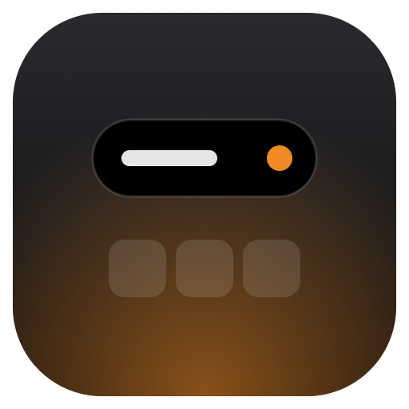

# Klon Notch

Windows için ekranın üstünde duran, Dynamic Island tarzı yüzen bir çentik. Fareyi çentiğin üzerine getirince araçlarla dolu bir panel açılır.



## Özellikler

- **Medya:** Windows'ta çalan şarkıyı kontrol etme, albüm kapağına göre renk alan arka plan, senkron şarkı sözleri (lrclib), ses düzeyi
- **Kapalı çentik:** saat ve pil, şarkı sözü kaydırma, zamanlayıcı, bildirimler, ses ve parlaklık göstergesi
- **Pano geçmişi:** metin ve resimler, arama ve sabitleme
- **Dosya rafı:** dosyayı çentiğe sürükleyip bırakma, telefona gönderme
- **Telefon bağlantısı:** QR kodla eşleştirme (uygulama gerekmez), iki yönlü dosya ve mesaj, birden fazla telefon
- **Takvim:** Windows Takvim ve ICS bağlantıları, hatırlatıcılar
- **Araçlar:** zamanlayıcı ve kronometre, ekran görüntüsü, metin yakalama (OCR), renk seçici, QR kod oluşturma, çeviri, döviz çevirici, hesap makinesi, notlar, metin araçları, sistem izleyici, hızlı başlat, ekranı uyanık tutma
- Düzenlenebilir sayfalar ve boyutu değiştirilebilir kutucuklar, kapsül ya da çentik görünümü, koyu ve açık tema, duvar kağıdından vurgu rengi

## Kurulum

[Releases](../../releases) sayfasından `Klon Notch-Setup-x.x.x.exe` dosyasını indirip çalıştırın; ya da kurulum gerektirmeyen `portable` sürümünü kullanın.

> Uygulama imzalı olmadığı için Windows SmartScreen uyarı verebilir: **Ek bilgi → Yine de çalıştır**.

## Geliştirme

```
npm install
npm start          # geliştirme modunda çalıştır
npm run dist       # dist/ klasörüne kurulum ve portable exe oluştur
```

Kısayol: **Ctrl+Alt+N** çentiği açık tutar.

Gereksinimler: Windows 10/11, Node.js 20+.

## Lisans

MIT
