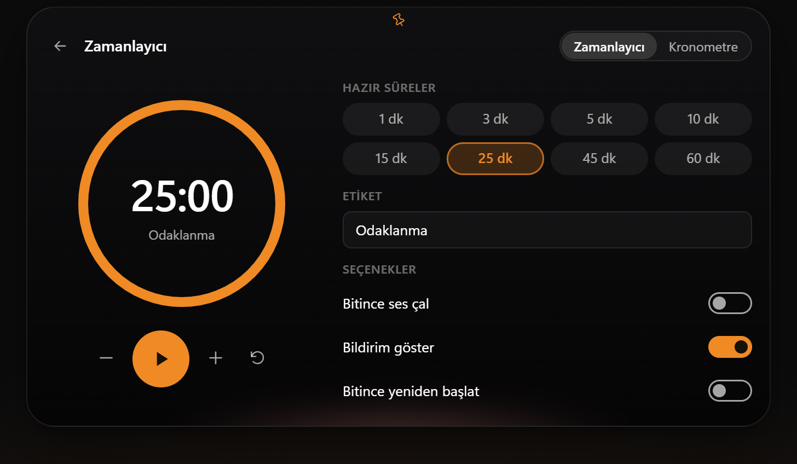
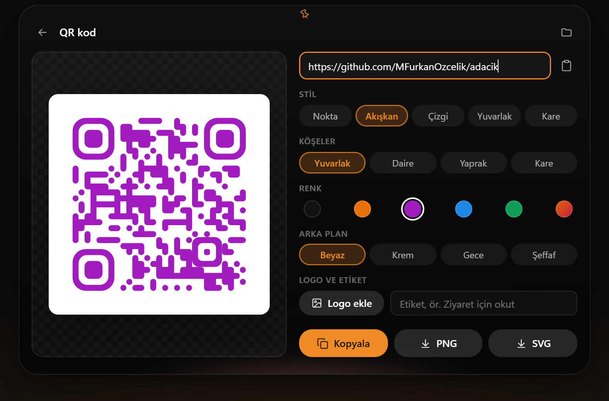

<div align="center">


<br>

[](https://github.com/MFurkanOzcelik/adacik/releases/latest)
[](https://github.com/MFurkanOzcelik/adacik/releases)

[](LICENSE)

**Ekranın üstünde duran küçük bir ada.** Fareyi üzerine getir; müziğin, bildirimlerin, panon, telefonun ve onlarca küçük araç tek dokunuş uzağında.

[**⬇ İndir**](https://github.com/MFurkanOzcelik/adacik/releases/latest) · [Özellikler](#-özellikler) · [Kurulum](#-kurulum) · [Gizlilik](#-gizlilik)

</div>

---

## ✨ Özellikler

<table>
<tr>
<td width="50%" valign="top">

### 🔔 Bildirimler
Windows bildirimleri adada, gönderen uygulamanın **gerçek simgesi** ve o uygulamanın renginde **dönen bir çerçeve** ile belirir. Tıkla: bildirimler sayfası açılır. Geçmiş, gün gün gruplanır; uygulamaya göre filtrelenir.

</td>
<td width="50%"></td>
</tr>
<tr>
<td width="50%"></td>
<td width="50%" valign="top">

### ⏱ Zamanlayıcı ve kronometre
Hazır süreler, etiket, ses ve bildirim. Panel kapalıyken geri sayım adanın içinde küçük bir halkayla akmaya devam eder.

</td>
</tr>
<tr>
<td width="50%" valign="top">

### 💱 Döviz çevirici
`100 usd to try`, `50 euro kaç tl` yaz, sonuç anında. Kurlar günlük güncellenir.

### 🔳 QR kod
Bağlantı ya da metinden şık QR kodlar: stil, köşe, renk, logo ve etiket. PNG / SVG olarak kaydet.

</td>
<td width="50%"><br><br></td>
</tr>
</table>

### Ve daha fazlası

| | | |
|---|---|---|
| 🎵 **Medya** — Windows'ta çalan her şeyi kontrol et, albüm kapağına göre renk alan buzlu cam arka plan, **senkron şarkı sözleri** | 📱 **Telefon bağlantısı** — QR kodu okut, uygulama kurmadan dosya ve mesaj gönder/al; birden fazla telefon | 📋 **Pano geçmişi** — metin ve resimler, arama, sabitleme |
| 📂 **Dosya rafı** — dosyayı adaya sürükle bırak, sonra istediğin yere taşı | 📅 **Takvim** — Windows Takvim ve ICS bağlantıları, hatırlatıcılar | 🌐 **Çeviri** — dil algılama, 25 dil |
| 📸 **Ekran görüntüsü** ve **metin yakalama (OCR)** | 🎨 **Renk seçici** — ekranın her yerinden, büyüteçle | 🖥 **Sistem izleyici** — canlı işlemci ve bellek halkası |
| 🔊 Ses ve parlaklık göstergesi | ☕ Ekranı uyanık tut | 🧮 Hesap makinesi, notlar, metin araçları, hızlı başlat |

**Kişiselleştirme:** kapsül ya da çentik görünümü · koyu / açık tema · duvar kağıdından otomatik vurgu rengi · sayfaları ve kutucuk boyutlarını düzenleme · tam ekranda gizlenme · açık sabitleme (<kbd>Ctrl</kbd>+<kbd>Alt</kbd>+<kbd>N</kbd>)

---

## 📦 Kurulum

1. [Son sürüm](https://github.com/MFurkanOzcelik/adacik/releases/latest) sayfasından indir:
   - **`Adacik-Setup-x.x.x.exe`** — kurulum (Başlat menüsü ve masaüstü kısayolu ekler)
   - **`Adacik-x.x.x-portable.exe`** — kurulum gerektirmez
2. Çalıştır. Ada ekranın üstünde belirir; fareyi üzerine getir.

> [!NOTE]
> Uygulama dijital olarak imzalı olmadığı için Windows SmartScreen uyarı verebilir: **Ek bilgi → Yine de çalıştır**.

> [!TIP]
> Bildirimlerin adada görünmesi için ilk açılışta Windows'un sorduğu **bildirim erişimi** iznini ver.

## 🔒 Gizlilik

- Hesap yok, kayıt yok, takip yok. Ayarlar, notlar ve pano geçmişi yalnızca bilgisayarında (`%APPDATA%`) saklanır.
- Telefon bağlantısı yalnızca **yerel Wi-Fi ağında** çalışır; dosyalar internete çıkmaz. Her telefonun kendi anahtarı vardır.
- Uygulama hiçbir API anahtarı içermez. Yalnızca anahtarsız, herkese açık servisler kullanılır: şarkı sözleri için [LRCLIB](https://lrclib.net), kurlar için [ExchangeRate-API](https://www.exchangerate-api.com), çeviri için Google Çeviri ve [MyMemory](https://mymemory.translated.net).

## 🛠 Geliştirme

```bash
git clone https://github.com/MFurkanOzcelik/adacik.git
cd adacik
npm install
npm start          # geliştirme modunda çalıştır
npm run dist       # dist/ klasörüne kurulum ve portable exe üret
```

Electron ile yazıldı. Windows tarafındaki işler (medya oturumu, ses, bildirimler, OCR, takvim) küçük PowerShell yardımcılarıyla Windows'un kendi API'lerinden okunur.

## 📄 Lisans

[MIT](LICENSE)
