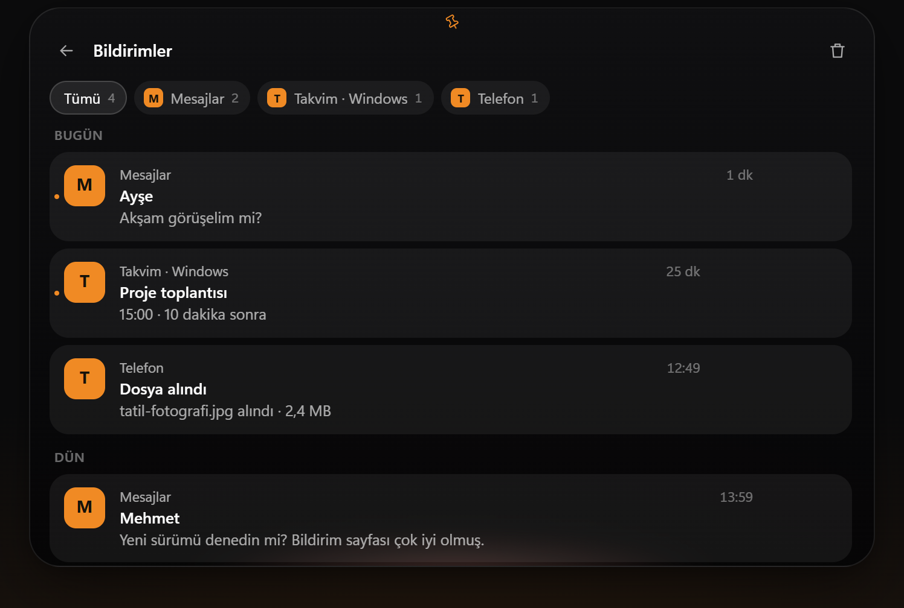

<div align="center">


<h3>A small island at the top of your screen.</h3>

<p>Hover over it and your music, notifications, clipboard, phone<br>and a few dozen handy tools are one click away.</p>

<a href="https://github.com/MFurkanOzcelik/adacik/releases/latest"></a>

<br><br>

[](https://github.com/MFurkanOzcelik/adacik/releases/latest)
[](https://github.com/MFurkanOzcelik/adacik/releases)


[](LICENSE)

<sub><a href="#-features">Features</a> &nbsp;·&nbsp; <a href="#-install">Install</a> &nbsp;·&nbsp; <a href="#-privacy">Privacy</a> &nbsp;·&nbsp; <a href="#-security">Security</a> &nbsp;·&nbsp; <a href="#-development">Development</a></sub>

</div>

<br>

> [!NOTE]
> **Adacık** — Turkish for *"little island"* — is a Dynamic Island–style companion for Windows 10 and 11. Its interface is in Turkish.

<br>

<table>
<tr>
<td align="center" width="33%"><h3>🫧</h3><b>Out of the way</b><br><sub>A slim pill with the time and battery. It grows only when you hover, or when something happens.</sub></td>
<td align="center" width="33%"><h3>⚡</h3><b>Light</b><br><sub>Around 1% of one CPU core while idle. Notifications reach the island in about 0.3 s.</sub></td>
<td align="center" width="33%"><h3>🔒</h3><b>Private</b><br><sub>No account, no telemetry, no API keys. Your data stays on your PC.</sub></td>
</tr>
</table>

## 📸 A closer look

<table>
<tr>
<td width="50%" valign="top"><p align="center"><sub><b>Notifications</b> — real app icons, history by day, filters</sub></p></td>
<td width="50%" valign="top"><p align="center"><sub><b>Timer &amp; stopwatch</b> — keeps counting inside the closed island</sub></p></td>
</tr>
<tr>
<td width="50%" valign="top"><p align="center"><sub><b>QR codes</b> — dot styles, colours, logo and label; PNG / SVG</sub></p></td>
<td width="50%" valign="top"><p align="center"><sub><b>Currency converter</b> — just type <code>100 usd to try</code></sub></p></td>
</tr>
</table>

## ✨ Features

<table>
<tr>
<td width="50%" valign="top">

#### 🏝 In the island
- **Notifications** with the app's real icon and a light that circles the island in its colour
- **Screenshot island** — after <kbd>Win</kbd>+<kbd>Shift</kbd>+<kbd>S</kbd>: read the text, shelve it, send it to your phone
- **Download & copy progress**, Bluetooth headphones and battery, camera / microphone indicator
- **Volume & brightness** indicator, now playing, timer ring
- **Do Not Disturb** — a tile, and it follows Windows' own Focus mode

</td>
<td width="50%" valign="top">

#### 📱 Connected
- **Phone link** — scan a QR code, no app needed: send and receive files and messages, **end-to-end encrypted**, several phones, each with a name
- **WhatsApp through Phone Link** — the chat and the text instead of *"You may have new messages"*
- **Media** — control whatever plays, artwork-tinted glass, **scrollable synced lyrics**
- **Calendar** — Windows Calendar and ICS links, reminders

</td>
</tr>
<tr>
<td width="50%" valign="top">

#### 🧰 Tools
- Clipboard history with images, search and pins
- File shelf · Notes · Calculator · Text tools
- Translation (25 languages) · Currency converter · QR codes
- Weather with a 6-day forecast · Colour picker · OCR
- System monitor · Start menu · Quick launch · Keep awake

</td>
<td width="50%" valign="top">

#### 🎨 Yours
- Notch or capsule shape · dark / light theme
- Accent colour from Windows or your wallpaper
- Tiles on several pages, **resized by dragging their edge**
- Media card pinned to the side, hide in full screen
- Pin the panel open with <kbd>Ctrl</kbd>+<kbd>Alt</kbd>+<kbd>N</kbd>
- **Automatic updates** from this repository

</td>
</tr>
</table>

## 📦 Install

1. Download **`Adacik-Setup-x.x.x.exe`** from the **[latest release](https://github.com/MFurkanOzcelik/adacik/releases/latest)**.
2. Run it. The island appears at the top of your screen — move the mouse over it.

The installer adds Start menu and desktop shortcuts, installs over an older version and keeps your settings. New versions download in the background and install when you quit (you can turn this off in Settings).

> [!TIP]
> Allow **notification access** when Windows asks on first start, so notifications can appear in the island.

> [!NOTE]
> The installer isn't code-signed, so SmartScreen may warn you: **More info → Run anyway**.

## 🔒 Privacy

**No account. No telemetry. No analytics. No API keys.** Settings, notes, clipboard and notification history stay on your computer, in `%APPDATA%\klon-notch`.

- **Phone link** works only inside your local Wi-Fi network and is end-to-end encrypted (NaCl secretbox). Every phone has its own key, every QR code pairs a single phone, every request carries a single-use token.
- **Notifications, camera / microphone use, downloads, Bluetooth and Do Not Disturb** are read from Windows on your PC and never sent anywhere. Text recognition uses Windows' built-in, offline OCR.

<details>
<summary><b>Every online service the app uses, and what it sends</b></summary>
<br>

Only public, key-less services, and only for the feature that needs them:

| Feature | Service | What is sent |
|---|---|---|
| Weather card | [Open-Meteo](https://open-meteo.com) | the coordinates of your city; the name you type when you search for a city |
| Weather, automatic location | [ipwho.is](https://ipwho.is), fallback [GeoJS](https://www.geojs.io) | your connection's IP address (city-level location) — not used once you pick a city; the card can be turned off |
| Synced lyrics *(off by default)* | [LRCLIB](https://lrclib.net) | the song's title, artist and length |
| Currency converter | [ExchangeRate-API](https://www.exchangerate-api.com) | only the request for today's rates |
| Translation | Google Translate, [MyMemory](https://mymemory.translated.net) | the text you translate |
| Calendar links you add | the server of that link | a normal request for the calendar |
| Updates | GitHub (this repository's releases) | a normal download request |

</details>

## 🛡 Security

- The app's windows only ever show the app itself: navigation, pop-ups and web views are blocked, and its internal commands are accepted only from its own pages.
- A strict Content Security Policy blocks foreign scripts, and all outside text (notifications, clipboard, messages, calendar events, song titles…) is escaped before it's shown.
- The phone link serves nothing without the phone's key; its page is sent with a strict CSP and security headers.
- No dependency shipped with the app has a known vulnerability (`npm audit --omit=dev`).

Found a vulnerability? Please report it privately via **[Report a vulnerability](https://github.com/MFurkanOzcelik/adacik/security/advisories/new)** rather than in a public issue.

## 🛠 Development

<details>
<summary><b>Build from source</b></summary>
<br>

```bash
git clone https://github.com/MFurkanOzcelik/adacik.git
cd adacik
npm install        # also builds the small Windows helper (helper/build.ps1)
npm start          # run in development mode
npm run dist       # build the installer into dist/
```

Built with Electron. The Windows side — media session, volume, notifications, camera / microphone, downloads, Bluetooth, Do Not Disturb — is read through Windows' own APIs by a small C# helper (`helper/helper.cs`), compiled on install with the C# compiler that ships with Windows (.NET Framework 4). OCR, calendar and app icons use small PowerShell scripts.

</details>

<br>

<div align="center">
<sub>Released under the <a href="LICENSE">MIT license</a> · Made with ☕ in Türkiye</sub>
</div>
