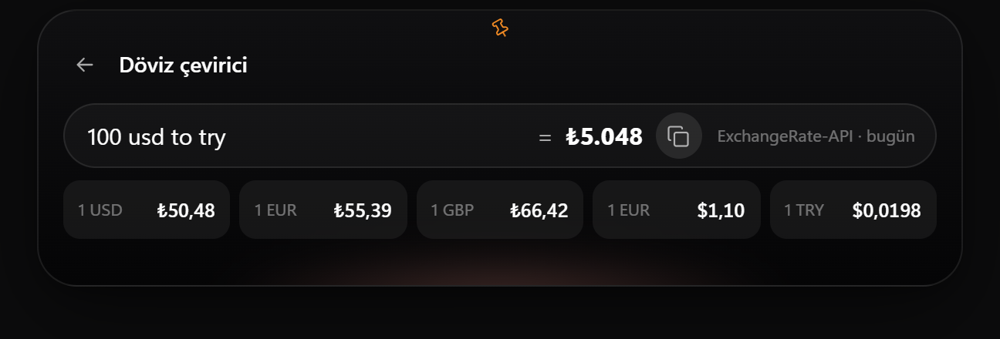

<div align="center">



<br>

[](https://github.com/MFurkanOzcelik/adacik/releases/latest)
[](https://github.com/MFurkanOzcelik/adacik/releases)

[](LICENSE)

**A small island that lives at the top of your screen.** Hover over it and your music, notifications, clipboard, phone and a few dozen handy tools are one click away.

[**⬇ Download**](https://github.com/MFurkanOzcelik/adacik/releases/latest) · [Features](#-features) · [Install](#-install) · [Privacy](#-privacy) · [Security](#-security)

</div>

> [!NOTE]
> Adacık ("little island" in Turkish) is a Dynamic Island–style companion for Windows 10 and 11. **Its interface is in Turkish.**

---

## ✨ Features

<table>
<tr>
<td width="50%" valign="top">

### 🔔 Notifications
Windows notifications appear in the island with the sending app's **real icon** and a **light that circles the island** in that app's colour. Click one to open the notifications page: history grouped by day, filter by app, open the app.

Messages relayed by **Phone Link** (WhatsApp, Instagram…) are shown as the app they came from, with the chat and the message, instead of WhatsApp's empty *"You may have new messages"*.

</td>
<td width="50%"></td>
</tr>
<tr>
<td width="50%"></td>
<td width="50%" valign="top">

### ⏱ Timer and stopwatch
Presets, a label, sound and notification. While the panel is closed the countdown keeps running as a small ring inside the island.

### 🌙 Do Not Disturb
A tile switches it on and off; it also follows Windows' own Do Not Disturb / Focus. Notifications are kept quietly in the history, and when it ends the island tells you what came in meanwhile.

</td>
</tr>
<tr>
<td width="50%" valign="top">

### 💱 Currency converter
Type `100 usd to try` or `50 euro kaç tl` and get the result instantly. Rates are updated daily.

### 🔳 QR codes
Stylish QR codes from a link or any text: dot style, corners, colours, logo and label. Save as PNG or SVG.

</td>
<td width="50%"><br><br></td>
</tr>
</table>

### And more

| | | |
|---|---|---|
| 🎵 **Media** — control whatever plays in Windows, a frosted background tinted by the album art, **scrollable synced lyrics** | 📱 **Phone link** — scan a QR code, no app to install: send and receive files (several at once) and messages; name your phones | 📸 **Screenshot island** — after <kbd>Win</kbd>+<kbd>Shift</kbd>+<kbd>S</kbd> the shot appears in the island: read its text, keep it on the shelf, send it to your phone |
| 📋 **Clipboard history** — text and images, search, pinning | 📂 **File shelf** — drop files on the island, take them out later | 📅 **Calendar** — Windows Calendar and ICS links, reminders |
| ⬇ **Downloads and copies** — progress right in the island | 🎧 **Bluetooth headphones** — connected, battery level, low-battery warning | 🟢 **Camera / microphone indicator** — which app is using them |
| ⛅ **Weather** — current conditions next to your tiles, 6-day forecast | 🌐 **Translation** — language detection, 25 languages | 🎨 **Colour picker**, 🖥 **system monitor**, 🔊 volume and brightness indicator |
| 🧮 Calculator, notes, text tools, quick launch, start menu | ☕ Keep the screen awake | 🔄 **Automatic updates** from this repository's releases |

**Make it yours:** capsule or notch shape · dark / light theme · accent colour from Windows or your wallpaper · arrange tiles across pages and resize them by dragging their edge · pin the media card to the side · hide in full screen · pin the panel open (<kbd>Ctrl</kbd>+<kbd>Alt</kbd>+<kbd>N</kbd>)

---

## 📦 Install

1. Download **`Adacik-Setup-x.x.x.exe`** from the [latest release](https://github.com/MFurkanOzcelik/adacik/releases/latest). It adds Start menu and desktop shortcuts, installs over an older version and keeps your settings.
2. Run it. The island appears at the top of the screen; move the mouse over it.

> [!NOTE]
> The installer isn't code-signed, so Windows SmartScreen may warn you: **More info → Run anyway**.

> [!TIP]
> To see notifications in the island, allow **notification access** when Windows asks on first start.

Updates are downloaded in the background and installed when you quit the app (or right away from the island). You can turn this off in Settings.

## 🔒 Privacy

There is **no account, no telemetry, no analytics and no API key** in the app. Settings, notes, clipboard history and notification history stay on your computer (`%APPDATA%\klon-notch`).

Only these public, key-less services are contacted, and only for the feature that needs them:

| Feature | Service | What is sent |
|---|---|---|
| Weather card | [Open-Meteo](https://open-meteo.com) | the coordinates of your city; the name you type when you search for a city |
| Weather, automatic location | [ipwho.is](https://ipwho.is), fallback [GeoJS](https://www.geojs.io) | your connection's IP address (city-level location). Not used once you pick a city; the card can be turned off |
| Synced lyrics (off by default) | [LRCLIB](https://lrclib.net) | the song's title, artist and length |
| Currency converter | [ExchangeRate-API](https://www.exchangerate-api.com) | nothing but the request for today's rates |
| Translation (when you translate) | Google Translate, [MyMemory](https://mymemory.translated.net) | the text you translate |
| Calendar links you add | the server of that link | a normal request for the calendar |
| Updates | GitHub (this repository's releases) | a normal download request |

Everything else stays local:

- **Phone link** works only inside your **local Wi-Fi network** and is **end-to-end encrypted** (NaCl secretbox). Every phone has its own key, every QR code pairs one phone only, and every request carries a single-use token. Files never go through the internet.
- **Notifications, camera/microphone use, downloads, Bluetooth and Do Not Disturb** are read from Windows on your computer and never sent anywhere.
- **Screenshot text recognition** uses Windows' built-in OCR, offline.

## 🛡 Security

- The windows only show the app's own pages: navigation, pop-ups and web views are blocked, and the app's internal commands are only accepted from those pages.
- A strict Content Security Policy blocks scripts that aren't part of the app, and every piece of outside text (notifications, clipboard, messages, calendar events, song titles…) is escaped before it's shown.
- The phone link server serves no data without the phone's key; the page itself is sent with a strict CSP and security headers.
- No dependency shipped with the app has a known vulnerability (`npm audit --omit=dev`).

Found a security problem? Please report it privately through GitHub's **[Report a vulnerability](https://github.com/MFurkanOzcelik/adacik/security/advisories/new)** instead of opening a public issue.

## 🛠 Development

```bash
git clone https://github.com/MFurkanOzcelik/adacik.git
cd adacik
npm install        # also builds the small Windows helper (helper/build.ps1)
npm start          # run in development mode
npm run dist       # build the installer into dist/
```

Built with Electron. The Windows side (media session, volume, notifications, camera/microphone, downloads, Bluetooth, Do Not Disturb) is read through Windows' own APIs by a small C# helper, `helper/helper.cs`, compiled on install with the C# compiler that ships with Windows (.NET Framework 4). OCR, calendar and app icons use small PowerShell scripts.

## 📄 License

[MIT](LICENSE)
